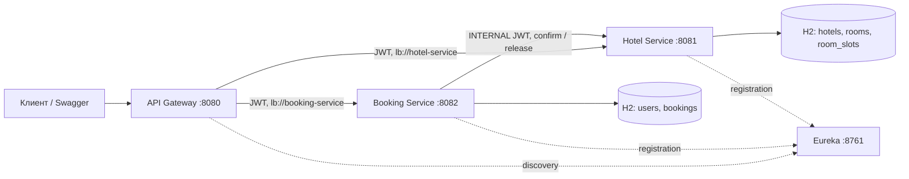

# hotel Service

В проекте я реализую REST API системы бронирования отелей на Spring Boot 3.5.6 и Spring Cloud 2025.0.0. Использую Java 17+ и Maven 3.9+.
Четыре самостоятельных приложения, две независимые H2 in-memory базы. Пользовательского интерфейса нет: работа через REST API и Swagger UI.



## Запуск через Docker Compose

Для запуска использую Docker с Docker Compose. Локальные Java, Maven и Python для запуска не нужны: Maven и JDK находятся в сборочном образе, JRE — в образах сервисов.

Из корня проекта выполняю:

```bash
docker compose up --build -d
```

Docker соберёт четыре образа и запустит сервисы в одной сети. Eureka запускается первым; зависимые сервисы ждут успешной HTTP-проверки готовности. В контейнерах используются имена сервисов Compose вместо localhost для межсервисных адресов. H2 остаётся in-memory, как требует ТЗ; отдельный контейнер базы данных не нужен.

Состояние контейнеров и логи проверяю командами:

```bash
docker compose ps
docker compose logs -f
# Логи только процесса бронирования:
docker compose logs -f booking-service hotel-service
```

Порты 8761, 8080, 8081, 8082 должны быть свободны. После запуска на регистрацию сервисов и обновление кэшей Eureka/LoadBalancer может потребоваться до 90 секунд. HTTP healthcheck показывает готовность приложения, но не завершение обновления discovery: если Gateway сначала возвращает 503, ожидаю обновления discovery и повторяю запрос.

Для остановки и удаления контейнеров выполняю:

```bash
docker compose down
```

После остановки JVM данные H2 исчезают; при запуске создаются демонстрационные данные. Для согласованной демонстрации перезапускаю весь набор сервисов вместе. После изменения Java-кода повторно выполняю `docker compose up --build -d`.

| Адрес | Назначение |
|---|---|
| http://localhost:8080 | Единая точка REST API |
| http://localhost:8761 | Реестр Eureka |
| http://localhost:8081/swagger-ui/index.html | Swagger Hotel Service |
| http://localhost:8082/swagger-ui/index.html | Swagger Booking Service |
| http://localhost:8081/v3/api-docs | OpenAPI Hotel Service |
| http://localhost:8082/v3/api-docs | OpenAPI Booking Service |

## Демонстрационные данные

| Логин | Пароль | Роль |
|---|---|---|
| admin | admin12345 | ADMIN |
| student | student12345 | USER |

Есть два отеля и пять номеров; номер 202 второго отеля выведен из эксплуатации. Три завершившихся по датам подтверждённых бронирования принадлежат `student`. Счётчики первых трёх номеров: 2, 1, 0. Это демонстрирует автоподбор, приоритет менее загруженных номеров, личную историю и статистику. Исторические брони и слоты имеют одинаковые детерминированные идентификаторы в обеих БД.

JWT выдаётся на один час. Регистрация всегда создаёт USER; назначить ADMIN можно только через административное API. Пароли хранятся как BCrypt-хэши. ADMIN выполняет административные операции; личные бронирования доступны роли USER.

## Пример использования

Для авторизации отправляю запрос (для регистрации нового пользователя использую `POST /user/register`):

```bash
curl -s http://localhost:8080/user/auth \
  -H 'Content-Type: application/json' \
  -d '{"username":"student","password":"student12345"}'
```

Значение поля `token` сохраняю в переменную:

```bash
TOKEN='полученный-JWT'
curl -s http://localhost:8080/api/hotels -H "Authorization: Bearer $TOKEN"
curl -s 'http://localhost:8080/api/rooms/recommend?startDate=2027-06-01&endDate=2027-06-04' \
  -H "Authorization: Bearer $TOKEN"
```

Для бронирования указываю будущие даты. Выезд не входит в занятый интервал: соседние брони допустимы.

```bash
curl -i http://localhost:8080/api/bookings \
  -H "Authorization: Bearer $TOKEN" -H 'Content-Type: application/json' \
  -d '{"requestId":"a19d9d02-78af-4c12-9689-f5f485ca7a77","autoSelect":true,"hotelId":1,"startDate":"2027-06-01","endDate":"2027-06-04"}'
```

При `autoSelect:false` передаю `roomId`. При `autoSelect:true` поле `roomId` игнорируется; необязательный `hotelId` ограничивает поиск. Новый запрос должен иметь новый UUID `requestId`; повтор того же запроса использует прежний UUID и возвращает прежнее бронирование без повторного резервирования. Идентификатор бронирования равен `requestId`. Повтор с другими данными возвращает 409.

```bash
curl -s 'http://localhost:8080/api/bookings?page=0&size=20' -H "Authorization: Bearer $TOKEN"
curl -s http://localhost:8080/api/bookings/a19d9d02-78af-4c12-9689-f5f485ca7a77 -H "Authorization: Bearer $TOKEN"
curl -s -X DELETE http://localhost:8080/api/bookings/a19d9d02-78af-4c12-9689-f5f485ca7a77 -H "Authorization: Bearer $TOKEN"
```

Для запросов из Swagger нажимаю **Authorize** и вставляю JWT. Документация открыта, операции требуют соответствующей роли.

## Эндпойнты

Booking Service (все доступны через Gateway):

| Метод | Путь | Доступ и назначение |
|---|---|---|
| POST | `/user/register` | Публичный: username, password → USER и JWT |
| POST | `/user/auth` | Публичный: username, password → JWT |
| POST | `/user` | ADMIN: username, password, role → пользователь |
| GET | `/user`, `/user/{id}` | ADMIN: список / пользователь |
| PATCH | `/user` | ADMIN: id, username, password, role → обновление |
| DELETE | `/user?id=…` | ADMIN: удаление пользователя без истории бронирований |
| POST | `/api/bookings` или `/booking` | USER: создание бронирования |
| GET | `/api/bookings` или `/bookings` | USER: своя история, page≥0, size=1…100 |
| GET | `/api/bookings/{id}` или `/booking/{id}` | USER: своё бронирование |
| DELETE | `/api/bookings/{id}` или `/booking/{id}` | USER: отмена своего бронирования |

Hotel Service:

| Метод | Путь | Доступ и назначение |
|---|---|---|
| GET | `/api/hotels?search=…` | USER/ADMIN: поиск по названию и адресу |
| GET | `/api/hotels/{id}` | USER/ADMIN: отель |
| POST | `/api/hotels` | ADMIN: name, address |
| PUT | `/api/hotels/{id}` | ADMIN: полное обновление name, address |
| DELETE | `/api/hotels/{id}` | ADMIN: удаление отеля без номеров |
| GET | `/api/rooms?startDate=…&endDate=…&hotelId=…` | USER/ADMIN: свободные номера; hotelId необязателен |
| GET | `/api/rooms/recommend?startDate=…&endDate=…&hotelId=…` | USER/ADMIN: те же номера, сортировка timesBooked ASC, id ASC |
| GET | `/api/rooms/{id}` | USER/ADMIN: номер |
| POST | `/api/rooms` | ADMIN: hotelId, number, available |
| PUT | `/api/rooms/{id}` | ADMIN: обновление номера; перенос между отелями запрещён |
| DELETE | `/api/rooms/{id}` | ADMIN: удаление номера без истории слотов |
| GET | `/api/rooms/statistics?startDate=…&endDate=…&hotelId=…` | ADMIN: счётчики, число броней за период, занятые дни и процент загрузки |
| POST | `/api/rooms/{id}/confirm-availability` | INTERNAL, напрямую :8081: requestId, startDate, endDate |
| POST | `/api/rooms/{id}/release` | INTERNAL, напрямую :8081: requestId |

Внутренние POST не маршрутизируются Gateway и требуют короткоживущего INTERNAL JWT и `X-Internal-Key`. Сервисные JWT создаёт только Booking Service. Gateway передаёт пользовательский Authorization; каждый бизнес-сервис самостоятельно валидирует JWT и проверяет роли через `@PreAuthorize`.

`available` обозначает эксплуатационную доступность (ремонт), а не календарную занятость. Статистика ограничивает занятые дни границами запрошенного периода. `timesBooked` — накопленное число неотменённых броней, включая исторические; компенсация и отмена уменьшают его ровно один раз. Номер с историей можно выключить через `available:false`.

Коды ответов: 201 — создание (включая идемпотентный повтор), 200 — чтение/обновление/отмена, 204 — удаление административного объекта; 400 — валидация, 401 — отсутствие/некорректность JWT, 403 — недостаточная роль, 404 — объект не найден или чужая бронь, 409 — конфликт/нет свободных номеров, 503 — недоступность Hotel. При неудачном создании брони ответ содержит её `CANCELLED` представление; другие ошибки используют единый `ErrorDto`: timestamp, status, message, traceId. `releasePending:true` означает, что фоновая компенсация ещё повторяется.

## Согласованность и устойчивость

1. Booking фиксирует PENDING в своей БД. Выбор номера фиксируется отдельной локальной транзакцией до удалённого confirm.
2. Hotel блокирует строку номера (`PESSIMISTIC_WRITE`), проверяет эксплуатационную доступность и отсутствие пересечения дат, сохраняет слот и увеличивает счётчик.
3. Booking переводит запись в CONFIRMED. При сбое — CANCELLED и вызов release.
4. Если release недоступен, сохраняется `releasePending`; задача каждые 5 секунд повторяет компенсацию. PENDING старше 30 секунд также восстанавливаются. Все шаги идемпотентны.

HTTP connect/read timeout — по 1000 мс. Не более трёх попыток с паузами 100, 200 мс. Ошибки 4xx не повторяются. Circuit Breaker: окно 6 вызовов, минимум 3, порог ошибок 50%, открытое состояние 5 секунд. Компенсация обходит Circuit Breaker и имеет собственные ограниченные повторы. Отсутствующий при release номер (404) считается уже освобождённым.

Автоподбор берёт первый свободный номер по счётчику и id. При конкурентном конфликте повторяет выбор, максимум 10 выборов за запрос. Дальше отменяет бронь. Строка бронирования блокируется при обработке шага: повторные доставки одного UUID сериализуются. Нет глобальных распределённых транзакций, Redis или брокера.

Сквозной заголовок `X-Request-Id` возвращается клиенту. Межсервисные вызовы помечаются `X-Request-Id=bookingId`; все шаги саги содержат `bookingId`, события — `event=…`. Hotel выводит в событии идентификатор слота, а traceId содержит идентификатор бронирования. Схема идентификаторов и защита от запоздалого confirm описаны в [ADR](docs/adr.md).

Параметры доступны в `*/src/main/resources/application.yml`. Можно изменить `JWT_SECRET`, `INTERNAL_KEY`, `EUREKA_URL` через окружение; значения JWT_SECRET должны совпадать у трёх сервисов, INTERNAL_KEY — у Booking и Hotel. Значения по умолчанию предназначены для локальной демонстрации.

## Тестирование

### Автоматические тесты по ТЗ

JUnit 5 + MockMvc проверяют CRUD, аутентификацию, роли, даты, пагинацию, личную историю, успешную сагу, сбои и компенсацию, конкурентные запросы и идемпотентность. HTTP-тесты с локальным тестовым сервером проверяют настоящие тайм-ауты, повторы и Circuit Breaker. WebTestClient проверяет безопасность Gateway, traceId и discovery-маршруты. Тестам не нужны запущенные Eureka или другие внешние сервисы.

Для выполнения тестов в Docker без локальных JDK и Maven использую:

```bash
# Сборочный этап содержит исходники, Maven, JDK и зависимости:
docker build --target build -t hotel-service-build .
# Запуск всех тестов и проверки форматирования:
docker run --rm hotel-service-build mvn -B verify
```

Обычная сборка образов выполняет `package -DskipTests`, поэтому тесты запускаются отдельной командой выше. Успешный результат — `BUILD SUCCESS`, без провалов и ошибок в наборах тестов.

При установленных JDK 17+ и Maven 3.9+ запускаю тесты локально:

```bash
mvn clean verify
# Отдельная проверка / исправление форматирования:
mvn spotless:check
mvn spotless:apply
```

### Ручная проверка через REST API или Swagger

Для ручной проверки запускаю `docker compose up --build -d` и выполняю примеры из раздела «Пример использования». При повторном создании брони меняю UUID requestId и указываю будущие даты.

| Сценарий | Действия | Ожидаемый результат |
|---|---|---|
| Discovery | Открываю http://localhost:8761 и выполняю GET /api/hotels через :8080 с JWT | Зарегистрированы три клиента; список отелей возвращается через Gateway |
| Регистрация и вход | POST /user/register, затем POST /user/auth | JWT на 3600 секунд; зарегистрирован USER |
| Аутентификация | GET /api/hotels без JWT или с испорченным токеном | 401 |
| Роли | С USER вызываю POST /api/hotels; повторяю с ADMIN | 403 для USER, 201 для ADMIN |
| Автоподбор | GET /api/rooms/recommend с датами; POST /booking с autoSelect=true | Список отсортирован по timesBooked, id; выбрана первая свободная комната |
| Ручной выбор | POST /booking с autoSelect=false и roomId | 201, статус CONFIRMED |
| Идемпотентность | Повторяю точно тот же POST с прежним requestId | Возвращается прежняя бронь, новая не создаётся |
| Конфликт ключа | Меняю даты или roomId, оставляя requestId | 409 |
| Пересечение дат | Создаю две брони одного номера на одинаковые даты с разными requestId | Первая CONFIRMED; вторая CANCELLED с HTTP 409 |
| Соседние даты | Создаю новую бронь с заездом в день выезда предыдущей | Бронь допустима |
| Валидация | Выезд раньше/в день заезда, прошлый заезд или нет roomId при ручном выборе | 400 |
| Владение | Регистрирую второго USER и запрашиваю/отменяю чужую бронь | 404; чужая бронь не меняется |
| История | GET /bookings?page=0&size=2 | Только свои брони, не больше двух на странице |
| Отмена | DELETE /booking/{id}, затем список свободных номеров на те же даты | CANCELLED; номер снова свободен, повтор отмены не уменьшает счётчик снова |
| Статистика | ADMIN: GET /api/rooms/statistics?startDate=…&endDate=… | Число броней, занятые дни, процент загрузки; USER получает 403 |
| Внутренние операции | USER: POST /api/rooms/1/release через Gateway | 403, маршрут не проксируется |

Параллельные запросы одного номера и одного requestId воспроизводятся автоматически в `InventoryIntegrationTest` и `BookingIntegrationTest`.

Для ручной проверки тайм-аута и компенсации временно приостанавливаю Hotel, сохраняя его H2 в памяти:

```bash
docker compose pause hotel-service
# С USER отправляю POST /booking с autoSelect=false, roomId=1,
# будущими датами и новым requestId.
# Ожидается 503, статус CANCELLED, releasePending=true.
docker compose unpause hotel-service
docker compose logs -f booking-service hotel-service
```

Приостановку выполняю после успешного обычного бронирования: так проверяется уже обнаруженный сервис. После восстановления Hotel фоновая задача повторит release; GET /booking/{id} должен показать CANCELLED и releasePending=false. В логах прослеживаются bookingId, ошибки вызовов и `event=compensation_completed`. Тайм-ауты, ограниченные повторы и открытие Circuit Breaker также покрыты `HotelHttpClientTest`.

## Документация модулей

- [Booking Service](booking-service/README.md)
- [Hotel Service](hotel-service/README.md)
- [API Gateway](api-gateway/README.md)
- [Eureka Server](eureka-server/README.md)
- [Общий модуль](common/README.md)
- [Схема данных](docs/database.md)
- [Решения ADR](docs/adr.md)
- [Результаты проверки](docs/verification.md)